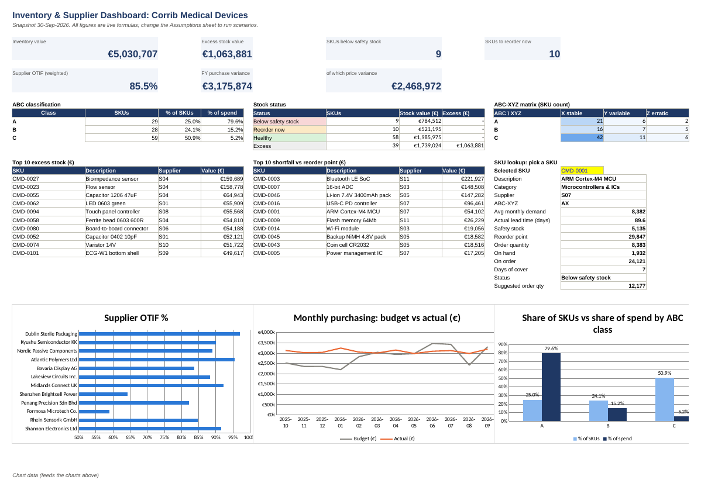
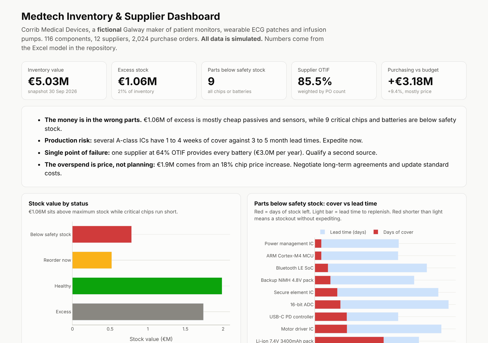

# Medtech Component Supply Chain & Inventory Optimisation

**"Too much stock, but we still run out of chips."** An Excel inventory and supplier model for a medical device
manufacturer that sets the right stock levels, frees up cash, and explains a €3.2M budget overspend.


**[Download the Excel model](excel/Corrib_Medtech_Inventory_Model.xlsx)** ·
**[Live interactive dashboard](https://ahmaduzzam31.github.io/medtech-supply-chain-inventory/)** ·
**[Analysis notebook](notebooks/inventory_analysis.ipynb)** ·
**[Executive summary](reports/executive_summary.md)**

> **Simulated data, fictional company.** *Corrib Medical Devices* is an invented Galway manufacturer of patient monitors,
> wearable ECG patches and infusion pumps. The data is generated by [`src/generate_data.py`](src/generate_data.py) to
> behave like a real component supply chain: production plan → bill of materials → demand, supplier-specific lead times
> and reliability, chip price increases, and batteries with shelf life.

---

## Business problem
The operations director has three complaints:
1. **Cash is tied up in stock**, yet production keeps running short of microcontrollers.
2. **Suppliers are unreliable**, but nobody can say which ones or by how much.
3. **Purchasing is €3.2M over budget.** Finance wants to know if planning failed.

## Key results

| | Finding |
|---|---|
| 💶 **Excess stock** | **€1.06M (21%)** of €5.03M inventory is above maximum stock, costing about **€234k a year** to carry. |
| 🚨 **Production risk** | **9 parts below safety stock, all chips or batteries.** Several A-class ICs have 1 to 4 weeks of cover against 3 to 5 month lead times. |
| 🏭 **Supplier risk** | Formosa Microtech at **59% OTIF**. Shenzhen Brightcell at **64% OTIF** and the **sole supplier of all 6 batteries** (€3.0M a year). |
| 📈 **Budget variance** | +€3.2M = **€1.9M chip price increase** + €0.5M other price + €0.7M volume/timing. **Price, not planning.** |
| 📊 **Pareto** | **25% of components = 80% of spend.** A-class parts get 98% service level and weekly review. |
| ✅ **Model validated** | The Excel results reconcile with an independent Python calculation: **0 mismatches across 116 SKUs**. |

### The Excel model


| Sheet | What it does | Excel skills |
|---|---|---|
| **Dashboard** | KPI tiles, ABC and status tables, ABC-XYZ matrix, top-10 excess and shortfall lists, **SKU lookup dropdown**, 3 charts | `INDEX/MATCH`, `LARGE`, `COUNTIF(S)`, data validation, charts |
| **Inventory_Policy** | Per SKU: ABC/XYZ class, service level, safety stock, reorder point, order quantity, status, excess, suggested order | `SUMIF` cumulative %, `STDEV`, `NORMSINV`, `AVERAGEIFS`, `SUMPRODUCT` (lead-time std dev), `ROUNDUP`, `EDATE` |
| **Supplier_Scorecard** | On-time %, in-full %, OTIF, days late, reject rate, actual lead time, rating | `COUNTIFS`, `SUMIFS`, `AVERAGEIFS`, colour scales |
| **Budget_vs_Actual** | 12-month budget vs actual by category, variance, **price vs volume bridge** | `SUMIFS` across sheets, conditional formatting |
| **Assumptions** | Every input in one place (yellow cells): service levels, holding cost, thresholds | Scenario-ready model design |
| **Data sheets** | Items, Demand, PO_Lines (+11 formula columns), Stock_Snapshot, Suppliers | Clean tabular structure, filters, frozen panes |

Change a service level or the holding cost on **Assumptions** and the whole model recalculates.

### Interactive dashboard


## Approach

| Step | What I did | Skills shown |
|---|---|---|
| 1. Data design | Simulated a realistic supply chain: 3 products, BOM explosion, 12 suppliers with different reliability, price shocks, shelf-life items | Domain modelling (ECE / manufacturing) |
| 2. Classification | ABC by spend (Pareto), XYZ by demand CV, ABC-XYZ matrix | Inventory analytics |
| 3. Policy | Safety stock with **both demand and lead-time variability** using **actual** PO lead times. ROP and order qty = max(EOQ, MOQ, 1 month) | Operations research, statistics |
| 4. Risk | Days of cover vs lead time for parts below safety stock. Expiry within 6 months | Risk analysis |
| 5. Suppliers | OTIF scorecard, single-source exposure, lead-time vs quote gap | Supplier performance management, SQL |
| 6. Finance | Budget vs actual with **price/volume variance bridge** | Financial analysis |
| 7. Validation | [`src/reconcile.py`](src/reconcile.py) recalculates the workbook in LibreOffice and reconciles it with Python | Model assurance |
| 8. Communication | Executive summary with owners, Excel dashboard and web dashboard | Stakeholder reporting |

## Repository structure
```
├── excel/Corrib_Medtech_Inventory_Model.xlsx   # main deliverable (live formulas)
├── data/                       # simulated CSVs: items, suppliers, bom, production_plan,
│                               #   demand_monthly, purchase_orders, inventory_snapshot, budget_monthly
├── sql/                        # supplier OTIF, lead time vs quote, price index, single-source exposure
├── notebooks/inventory_analysis.ipynb
├── src/
│   ├── generate_data.py        # simulation (seeded, reproducible)
│   ├── build_workbook.py       # writes the Excel model with openpyxl
│   ├── reconcile.py            # Excel vs Python validation
│   └── build_dashboard.py      # -> docs/index.html
├── reports/
│   ├── executive_summary.md
│   ├── reconciliation.csv
│   └── figures/
└── docs/index.html             # web dashboard (GitHub Pages)
```

## Reproduce
```bash
pip install -r requirements.txt      # plus LibreOffice for the reconciliation step
./run_all.sh
```

## Key formulas
```
Safety stock   = z × √( LT/30.4 × σ_demand² + avg_demand² × (σ_LT/30.4)² )
Reorder point  = avg_demand × LT/30.4 + safety stock
Order quantity = MAX( EOQ, MOQ, 1 month of demand ),  EOQ = √( 2 × annual demand × order cost / (holding rate × unit cost) )
Status         = Below safety stock → Reorder now (position ≤ ROP) → Excess (on hand > SS + order qty) → Healthy
```

## Why this project
Before business analysis I studied **Electronics & Communication Engineering**, so I know why a single microcontroller
or battery can stop a medical device line, and why chip lead times and allocation matter. This project combines that
knowledge with core analyst tools: Excel modelling, SQL, variance analysis and clear recommendations. It is aimed at
the operations and supply chain analyst roles common in Ireland's medtech sector.
